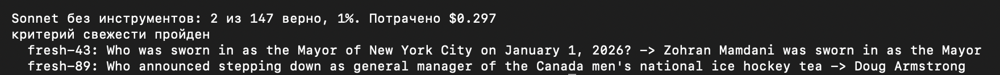
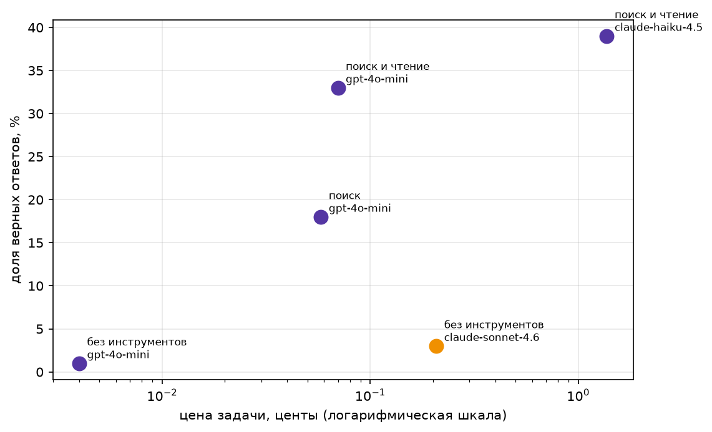
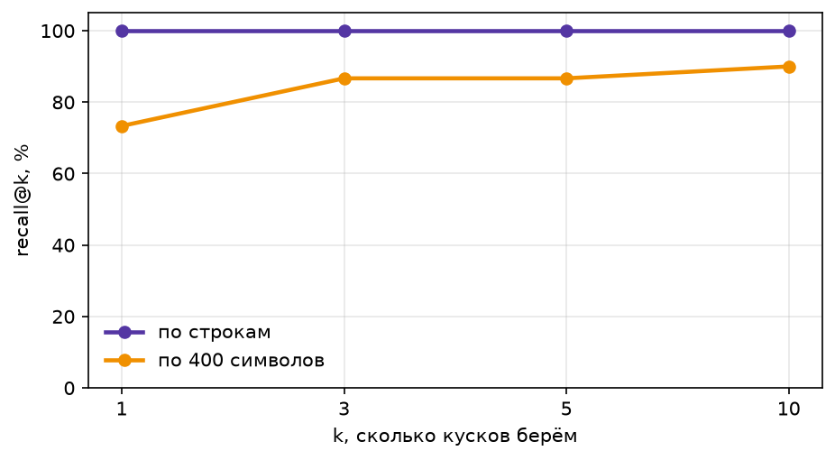
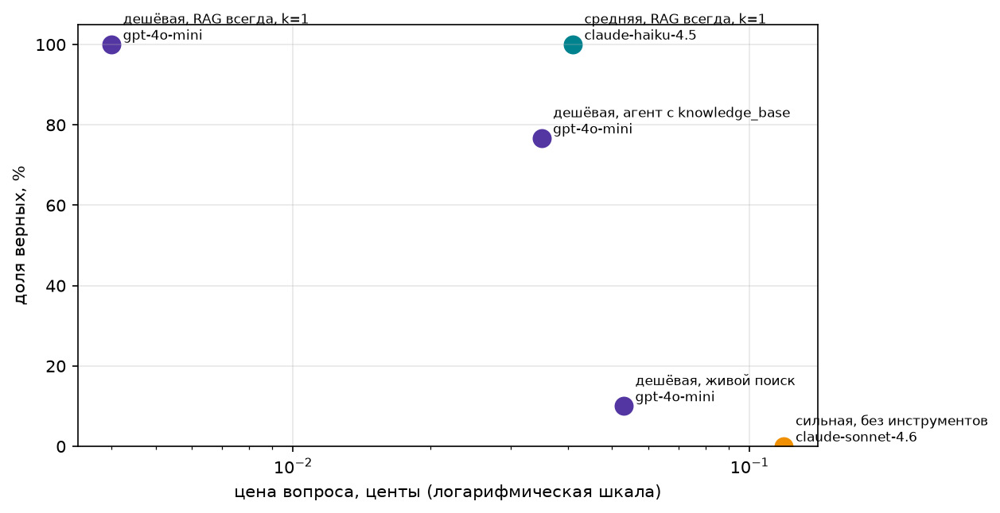
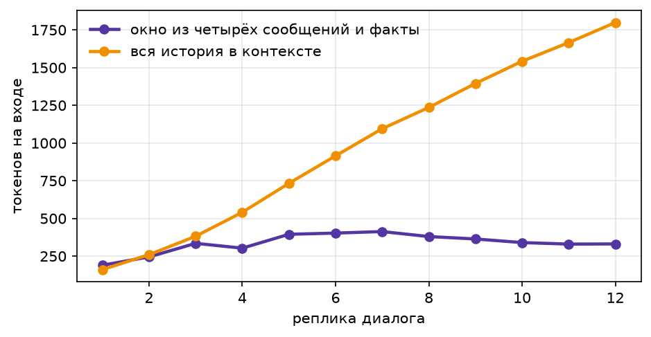

# Домашнее задание 1

## Датасет

`data/fresh.jsonl`, 147 вопросов: стартовый набор семинара (125) плюс 22 своих вопроса про космос (`fresh-125`…`fresh-146`) по новостям nasa.gov за 2026 год (составил датасет с помощью нейронки).

Проверка свежести (`python check_fresh.py data/fresh.jsonl --sonnet`):



## Агент

Ноутбук `ai-agent-01.ipynb`. Инструменты: `web_search`, `page_find`, `calculator`, `python_exec`, тесты лежат в спринте 5.

## Результаты (147 вопросов, потрачено $2.52)

| Конфигурация | Модель | Доля верных | Цена задачи, $ | Цена верного, $ | Шагов | Секунд |
|---|---|---|---|---|---|---|
| без инструментов | claude-sonnet-4.6 | 3% | 0.00208 | 0.07634 | 1.00 | 3.9 |
| без инструментов | gpt-4o-mini | 1% | 0.00004 | 0.00644 | 1.00 | 2.5 |
| поиск | gpt-4o-mini | 18% | 0.00058 | 0.00328 | 4.74 | 18.1 |
| поиск и чтение | gpt-4o-mini | 33% | 0.00070 | 0.00215 | 4.88 | 18.1 |
| поиск и чтение | claude-haiku-4.5 | 39% | 0.01372 | 0.03537 | 3.65 | 15.7 |



## Два провала

1. [fresh-47](<traces/поиск и чтение/gpt-4o-mini/fresh-47.json>): ответ верный, но не прошёл проверку. Агент написал `Minister of Education`, а эталон `Education Minister`.
2. [fresh-10](<traces/поиск и чтение/gpt-4o-mini/fresh-10.json>): поиск нашёл не то. Все шаги возвращали «List of fireworks accidents and incidents» вместо «2026 in China».

## Запуск

```
pip install -r requirements.txt
cp .env.example .env   # вписать OPENROUTER_API_KEY
```

Итоговый прогон делает последняя ячейка, трейсы пишутся в `traces/`.

# Домашнее задание 2. RAG и память

Ноутбук: [`home_works/hw2.ipynb`](home_works/hw2.ipynb). Запуск: `docker compose up -d`, ключ `OPENROUTER_API_KEY` в `.env`, `pip install -r requirements.txt`. Весь прогон стоит $0.11.

## Корпус и нарезка

13 обзорных страниц Википедии «2026 in …» (`data/corpus_2026.jsonl`, скачивает `utils/fetch_corpus.py`). Вопросы: `data/fresh_it_2026.jsonl`, 30 с ответом и цитатой `evidence` и 10 без ответа.

* Наивная нарезка: по 400 символов, 1325 кусков.
* Осмысленная: по строкам, 3160 кусков. Страница «2026 in …» это список событий: одна строка соответствует одному событию, а заголовок над ней задаёт месяц. Поэтому граница проходит по строке, а месяц становится метаданными для фильтра.

Метаданные куска: `page`, `section`, `month`, `url`. Фильтр в демонстрации: `page == "2026 in the United States" and month == "February"`.

## Поиск



| k | по строкам | по 400 символов |
|---|---|---|
| 1 | 1.00 | 0.73 |
| 5 | 1.00 | 0.87 |
| 10 | 1.00 | 0.90 |

**Выбрано k = 1.** На строках верный кусок всегда первый, поэтому каждый лишний кусок это оплаченный шум. Инструмент агента отдаёт 5 кусков, чтобы был запас на фильтры и переформулированные запросы.

Гибрид на нарезке по 400 символов:

| поиск | recall@1 | recall@5 |
|---|---|---|
| вектор | 0.73 | 0.87 |
| слова | 0.90 | 0.97 |
| гибрид RRF | 0.80 | 0.93 |

## Ответы и деньги

| Конфигурация | Доля верных | Цена вопроса, $ | Цена верного, $ |
|---|---|---|---|
| сильная (Sonnet 4.6), без инструментов | 0% | 0.00119 | — |
| дешёвая (gpt-4o-mini), живой поиск | 10% | 0.00053 | 0.00530 |
| дешёвая, RAG всегда, k=1 | 100% | 0.00004 | 0.00004 |
| дешёвая, агент с `knowledge_base` | 77% | 0.00035 | 0.00046 |
| средняя (Haiku 4.5), RAG всегда, k=1 | 100% | 0.00041 | 0.00041 |



Отказы:

| Конфигурация | Честно отклонено (из 10 без ответа) | Зря отклонено (из 30 с ответом) |
|---|---|---|
| сильная, без инструментов | 10 | 28 |
| дешёвая, живой поиск | 8 | 26 |
| дешёвая, RAG всегда | 10 | 1 |
| дешёвая, агент с `knowledge_base` | 10 | 6 |
| средняя, RAG всегда | 10 | 0 |

## Два провала

У лучшей конфигурации ошибок нет, поэтому разобраны ошибки агента с `knowledge_base`: 6 раз «поиск не нашёл», 1 раз «нашёл, но ответ неверный».

1. **Поиск не нашёл.** Вопрос про потребление электроэнергии дата-центрами по отчёту UN University (эталон 945 TWh). Агент сам поставил фильтр на страницу «2026» и июнь, а нужная строка лежит на странице «2026 in science». В контексте оказались El Niño, чемпионат мира и Ле-Ман, и агент ответил NOT_FOUND. Что менять: промпт инструмента. Фильтр по странице нужно ставить только при уверенности, а после пустого результата повторять поиск без фильтра.
2. **Нашёл, но ответ «неверный».** Вопрос про инвестиции Rachel Reeves в квантовые вычисления и AI. Верная строка пришла первой, агент ответил «£2.5 billion», а эталон «£2.5bn». Ответ верный, ошибается проверка. Что менять: нормализацию в `is_correct` (bn = billion, m = million).

## Память

* Эпизодическая: журнал `memory/episodes.jsonl` с сессией и временем, в контекст не идёт.
* Семантическая: факты в коллекции Milvus `hw2_facts`. id записи это хеш ключа темы (`city`, `job`…), поэтому новый факт заменяет старый через upsert.
* Две сессии: в первой Саша из Москвы рассказывает о себе, во второй агент отвечает «в моей теме» про чипы, а после переезда в памяти лежит `city: живёт в Берлине` вместо Москвы.
* Тесты без модели: пустая память, найденный факт, заменённый факт.



На диалоге из 12 реплик: «вся история» 11 725 токенов на входе и $0.00164, «окно из четырёх сообщений и факты» 4 029 токенов и $0.00090.

## Вывод

Тезис подтвердился. На тех же 30 вопросах дешёвая модель с живым поиском из первой домашки платит $0.0053 за верный ответ и отвечает на 10%. С RAG она платит $0.00004 и отвечает на все 30, то есть верный ответ подешевел примерно в 130 раз. Экономия за счёт того, что в контекст идёт одна нужная строка вместо страниц Википедии и не нужны шаги агента. Агент, который сам решает, когда искать, оказался и дороже, и хуже, чем «RAG всегда»: он лишний раз ставит фильтры и тратит шаги. Честная оговорка: вопросы составлены по цитатам и лексически близки к своим строкам, поэтому recall@1 = 1.0 здесь заметно лучше, чем было бы на вопросах живых пользователей.
